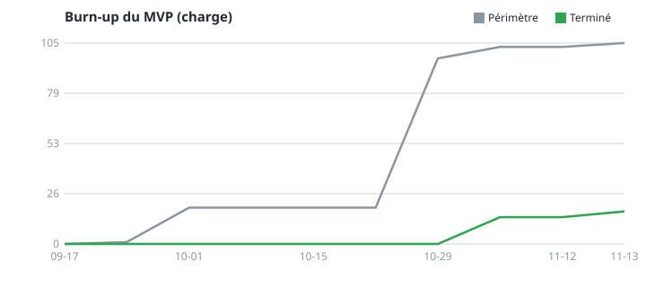
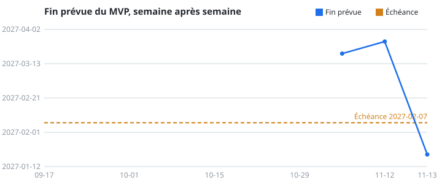
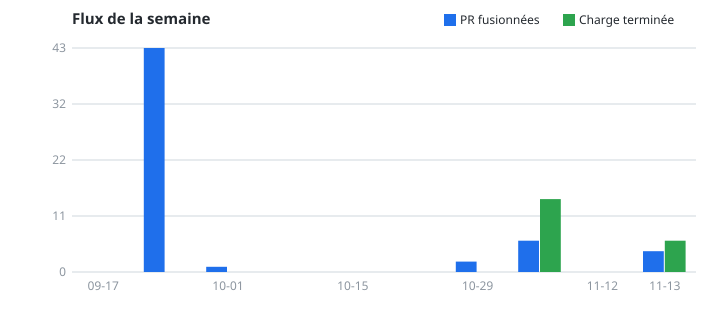

# Suivi du projet — vue client

Instantané du **2026-11-13**, calculé automatiquement depuis GitHub chaque semaine par `tools/suivi.dart` (workflow `suivi`). Ne pas éditer à la main. Les définitions sont celles de `docs/PROCESS.md` (§ Le suivi).

## Les jalons

Débit des trois dernières semaines : **8.7** de charge par semaine. La fin prévue d'un jalon cumule le reste des jalons qui le précèdent.

| Jalon | Terminé / total | Reste | Ajouté en cours | Fin prévue |
|---|---|---|---|---|
| J1 · Follow-up 2 (13/11) | 20 / 25 | 5 | 11 | 2026-11-18 |
| J2 · Follow-up 3 (18/12) | 6 / 44 | 38 | 0 | 2026-12-18 |
| J3 · Gel du MVP (21/01) | 0 / 35 | 35 | 0 | 2027-01-15 |
| J4 · Oral et rendu (05-07/02) | 0 / 4 | 4 | 0 | 2027-01-19 |
| S2 · Après le MVP | 0 / 3 | 3 | 0 | 2027-01-21 |

## À surveiller

- J1 · Follow-up 2 (13/11) : 11 de charge ajoutée en cours de jalon (44 %, seuil 10 %).
- 7 ticket(s) sans mouvement depuis 14 jours.

## Avancement

En gris, le périmètre du MVP (charge des tickets des jalons à échéance) ; en vert, la charge terminée. Un écart qui se creuse ou une courbe verte plate signale un blocage.

Chaque point est la fin prévue du MVP calculée cette semaine-là (reste divisé par le débit des trois semaines précédentes), face à l'échéance du 2027-02-07. Un point manquant : débit nul, aucune date calculable.

## Flux

| Indicateur | Valeur |
|---|---|
| Temps de cycle médian (premier commit → fusion) | 0.1 j |
| Âge du plus vieux ticket en cours | 17.1 j |
| Tickets sans mouvement depuis 14 jours | 7 |
| Délai médian avant la première relecture | — |
| PR fusionnées relues par une autre personne | 0 % |

## Qualité

| Indicateur | Valeur |
|---|---|
| Tests (unité / widget / intégration / SQL) | 197 / 9 / 1 / 82 |
| Couverture du code de l'app (`lib/`) | 88 % |
| CI verte sur 4 semaines | 100 % |

## Contenu

- Pins rédigés / relus / publiés : 0 / 0 / 0 (cible : 7 à 10)
- Modèle 3D : droits

## Semaine par semaine

| Date | Périmètre | Terminé | Reste | Débit | Fin prévue | PR fusionnées | Charge de la semaine | CI verte |
|---|---|---|---|---|---|---|---|---|
| 2026-09-17 | 0 | 0 | 0 | 0.0 | — | 0 | 0 | — |
| 2026-09-24 | 1 | 0 | 1 | 0.0 | — | 43 | 0 | 84 % |
| 2026-10-01 | 19 | 0 | 19 | 0.0 | — | 1 | 0 | 100 % |
| 2026-10-08 | 19 | 0 | 19 | 0.0 | — | 0 | 0 | — |
| 2026-10-15 | 19 | 0 | 19 | 0.0 | — | 0 | 0 | — |
| 2026-10-22 | 19 | 0 | 19 | 0.0 | — | 0 | 0 | — |
| 2026-10-29 | 97 | 0 | 97 | 0.0 | — | 2 | 0 | 100 % |
| 2026-11-05 | 103 | 14 | 89 | 4.7 | 2027-03-19 | 6 | 14 | 100 % |
| 2026-11-12 | 103 | 14 | 89 | 4.7 | 2027-03-26 | 0 | 0 | — |
| 2026-11-13 | 108 | 26 | 82 | 8.7 | 2027-01-19 | 6 | 12 | 100 % |

## Limites connues

- **Reconstitution.** Les charges et les jalons n'existent que depuis le recadrage du 26/10/2026. La série est recalculée avec les étiquettes `charge:N` et les jalons **tels qu'ils sont aujourd'hui** : avant le 26/10/2026, elle ne reflète pas ce qui était prévu à l'époque, et les tickets d'avant le recadrage (sans charge) n'y figurent pas.
- Un ticket fermé compte comme terminé, quelle que soit la raison de sa fermeture ; un ticket rouvert compte comme jamais terminé.
- La CI ne compte que les runs déclenchés par une PR (les 500 plus récents) ; la couverture n'est mesurée que si le rapport lcov de l'app existe au moment du calcul.
- Les fichiers `instantanes/instantane-AAAA-MM-JJ.json` sont les instantanés bruts de chaque semaine ; `historique.json` est la série ci-dessus.
